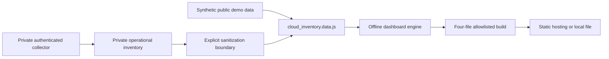

# Cloud Ledger Dashboard: Engineering Overview

Cloud Ledger turns fragmented cloud-control-plane observations into a cost-first, offline-capable dashboard. The public repository isolates the reusable visualization engine from the private collector and operational inventory.

## At a glance

| Area | Implementation |
| --- | --- |
| Core stack | Static HTML, CSS, JavaScript, Node build script, Cloudflare Workers Static Assets |
| Data model | Accounts, projects, billing coverage, budgets, services, quotas, Firebase, resources, risks, spend |
| Runtime | Offline `file://` dashboard and four-file allowlisted static bundle |
| Privacy model | Public synthetic payload; private collection, diagnostics, evidence, backups, and real inventory |
| Verification | Deterministic build, allowlisted asset count, current-snapshot secret scan |

## Why this project is technically interesting

- **Unknown cost is not displayed as zero.** Visibility and unavailability are modeled separately from actual spend.
- **The dashboard works offline.** A JavaScript data payload avoids fetch/CORS requirements and keeps the operator workflow simple.
- **Publishing is allowlisted.** The build copies only the HTML, CSS, application JavaScript, and approved data payload.
- **Privacy is architectural.** The public visualization repository cannot accidentally include the private collector history.

## System shape

## Guided code tour

1. **`assets/app.js`** — filtering, cost visibility, drill-down, risk, and relationship views.
2. **`assets/styles.css`** — responsive dashboard design system.
3. **`index.html`** — offline application shell and navigation.
4. **`data/cloud_inventory.data.js`** — explicitly synthetic public demonstration payload.
5. **`schemas/`** — private-collector-compatible inventory and app-registry contracts.
6. **`scripts/build-cloudflare-site.mjs`** — fixed four-file publication allowlist.

## Engineering decisions worth discussing

### Visibility is data

Missing permissions, unavailable exports, and incomplete account coverage remain visible so operators do not mistake absence for safety or zero cost.

### Offline-first delivery

The dashboard is usable without a server, package runtime, or live cloud credentials.

### Split public and private repositories

The full Cloud Ledger history contains operational account metadata. Keeping it private and publishing a separate code-only surface is safer than relying on a late-stage redaction.

## Verification

- `npm run build` produces exactly four allowlisted static assets.
- npm reports no known vulnerabilities for the small build dependency set.
- Git-history and snapshot scans found no secret in this public code-only repository.
- The demonstration payload uses reserved example domains and synthetic identifiers only.

## For coding agents

1. Never copy private inventory, evidence, diagnostics, backups, account emails, project IDs, or billing IDs into this repository.
2. Preserve `file://` support.
3. Keep the build allowlist explicit and small.
4. Represent unavailable spend as unavailable, never as zero.
5. Re-run the secret scan and build before publication.

## Current boundaries

- The public payload is synthetic and does not prove current cloud-account state.
- Collection and authentication live outside this repository.
- Static hosting should receive only the allowlisted build output.

## What this repository demonstrates

Cloud Ledger demonstrates privacy-aware cloud tooling: operational data modeling, honest cost visibility, offline delivery, explicit publication boundaries, and a reusable dashboard separated from sensitive collection state.
